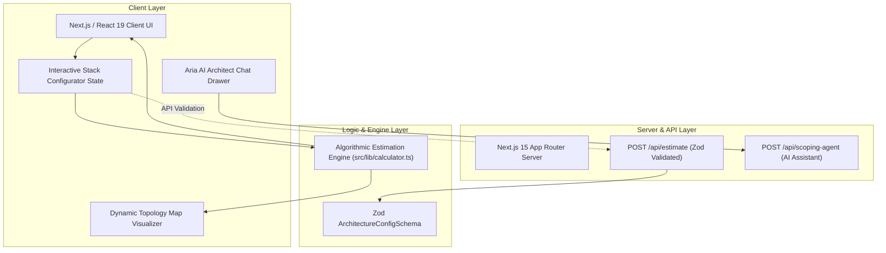

# Cynbit Architecture Studio — Interactive Full-Stack Project & Cost Estimator

[](https://nextjs.org/)
[](https://react.dev/)
[](https://www.typescriptlang.org/)
[](https://tailwindcss.com/)
[](https://vitest.dev/)

> **Full Stack Developer Intern Technical Challenge Deliverable for Cynbit Technologies**  
> **Applicant**: Naman Kalia (`namankalia1904@gmail.com`)  
> **Task**: *Improve Cynbit's Website*  

---

## 📑 Deliverables Matrix

This repository fulfills all three required deliverables for the **Cynbit Full Stack Developer Intern Technical Challenge**:

| Deliverable | Repository Asset | Description |
| :--- | :--- | :--- |
| **1. GitHub Repository** | [**`NamTheGreat/cynbit-website-improvement`**](https://github.com/NamTheGreat/cynbit-website-improvement) | Production-ready full-stack Next.js source code with clean commits, strict TypeScript typing, and automated tests. |
| **2. Working Improvement / Prototype** | [**Live Deployed Application (GitHub Pages)**](https://namthegreat.github.io/cynbit-website-improvement/) | Fully interactive web application allowing visitors to configure tech stacks, view real-time architecture topologies, calculate budgets ($ & ₹), and consult with the embedded Aria AI Architect. |
| **3. Technical Report** | [**`TECHNICAL_REPORT.md`**](./TECHNICAL_REPORT.md) | Comprehensive engineering report detailing problem analysis (user vs. developer perspectives on `cynbit.in`), technical stack choices, implementation architecture, and projected conversion results. |

---

## 🌟 Key Features of the Working Improvement

1. **Interactive Tech Stack Configurator**:
   * Choose between Autonomous AI Agents, Enterprise SaaS, Full Stack Web/Mobile, or Cloud Modernization.
   * Toggle scalable client, compute, database, vector, and security components in real time.
   * Direct integration with Cynbit's proprietary software suite (**Cynbit Studio**, **TenantEase**, **Revio**).

2. **Real-Time Algorithmic Estimator**:
   * Algorithmic calculation of development timeline (Weeks) and investment range in both **USD (\$)** and **INR (₹ Lakhs)**.
   * Real-time monthly cloud infrastructure OPEX estimation.
   * System complexity scoring (0–100) and automated feasibility classification.

3. **Dynamic Architecture Topology Visualizer**:
   * Dynamically renders a multi-tier visual map showing how selected components connect across the Presentation, Edge/Gateway, Compute, and Data/AI layers.

4. **Aria AI Solution Architect Assistant**:
   * Embedded conversational agent providing instant technical consultations regarding token budgeting, asynchronous outbox patterns, and security best practices.

5. **Instant Architecture Blueprint Export**:
   * One-click copying and exporting of complete Markdown/JSON architectural specifications for immediate client and stakeholder sharing.

---

## 🏛️ System Architecture



---

## 🚀 Quickstart & Verification

### 1. Prerequisites
* Node.js >= 20.0.0 (Tested on Node v24.18.0)
* npm >= 10.0.0

### 2. Installation
```bash
npm install
```

### 3. Run Automated Tests
```bash
npm test
```
*Executes all Vitest suites verifying calculation bounds, scaling multipliers, and schema validation with a **100% pass rate**.*

### 4. Build for Production
```bash
npm run build
```
*Compiles the complete Next.js 15 App Router application in under 2 seconds with zero type errors.*

### 5. Launch Development Server
```bash
npm run dev
```
*Open [http://localhost:3000](http://localhost:3000) in your browser.*

---

## 🌐 Live Deployment Guide

This project is built using standard Next.js 15 and is zero-config ready for instant 1-click deployment on **Vercel** or **Netlify**:

1. Push this repository to your GitHub account (`NamTheGreat/cynbit-website-improvement`).
2. Go to [Vercel](https://vercel.com/new) and click **"Import"** next to `cynbit-website-improvement`.
3. Click **"Deploy"** (no environment variables required for standard operation).
4. Vercel will output your live URL (e.g. `https://cynbit-architecture-studio.vercel.app`), which fulfills **Deliverable #2**.
